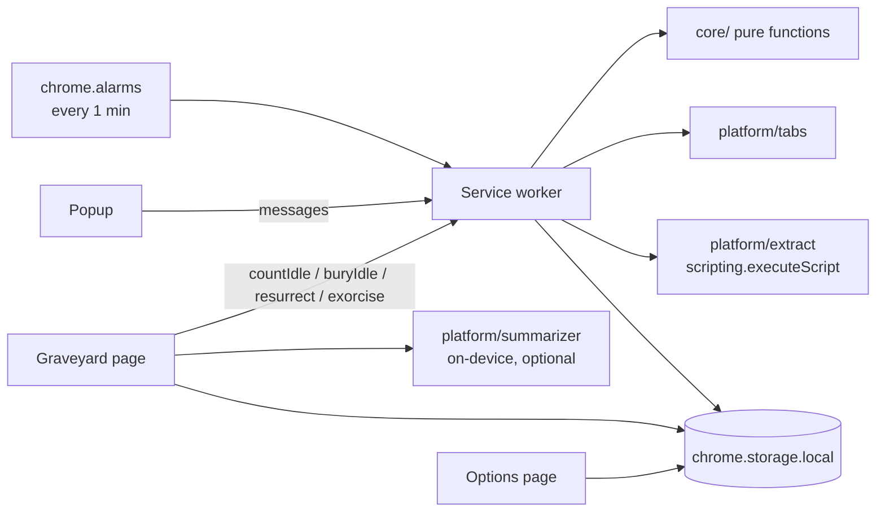

# Design Document

## Overview

Rest in Tabs is a Manifest V3 extension with no backend. A service worker wakes on a one-minute alarm, asks pure functions which tabs to bury, saves a Grave for each, and closes the tab. The Graveyard page reads Graves from `chrome.storage.local` and renders them as tombstones.

Two decisions shape the design:

1. **All decisions are pure functions.** Selection, deduplication, decay, expiry, epitaph and search take plain data and return plain data. Only thin adapters touch `chrome.*`. This makes the risky logic (closing the user's tabs) property-testable.
2. **Save before close, open before delete.** A tab is closed only after its Grave is stored; a Grave is removed only after its tab is reopened. A failure at any point leaves the user with a duplicate, never a loss.

## Architecture



### Burial flow

1. Alarm fires, the Popup or Graveyard sends `buryIdle` (the "Bury N idle tabs" button), or the Popup sends `buryTab`.
2. Service worker loads settings and queries all tabs. This one snapshot is used for selection and for Duplicate counts.
3. The alarm uses `selectAutomaticCandidates(tabs, settings, installedAt, now)`. `buryIdle` uses `selectManualCandidates(tabs, settings, now)`, which is `selectBurialCandidates` with `autoBury` forced to `true`, so idle tabs are buried even when Auto-Bury is disabled (Requirement 2.2 applies regardless of Requirement 1.6). `countIdle` uses the same `selectManualCandidates`, so the button count and the burial agree.
4. For each candidate: extract page info (2 s timeout) → fetch the tab again with `getTab` and skip it if it is gone, now shows a different URL, or (alarm runs and `buryIdle`, not `buryTab`) is now protected or no longer idle → `createGrave(tab, page, now, id, countDuplicates(snapshot, tab.url))` → `addGrave` → enqueue one `setGravesAndStats` write → on success `tabs.remove`. `buryTab` also queries all tabs, only to compute the Duplicate count.
5. `expireGraves` runs on the same alarm, before burial, and removes Graves past the Retention Period through the same write queue.

### Resurrection flow

1. Graveyard sends `resurrect(id)`.
2. Service worker calls `tabs.create({ url })`. On success it enqueues a write to remove the Grave and increment `stats.resurrected`. On failure it replies with an error and the Grave stays.

### Idle count (`countIdle`)

The Popup and Graveyard label their "Bury N idle tabs" button with the reply to `countIdle` (Requirement 4.10).

1. The page sends `countIdle`. The service worker loads settings, queries tabs, and replies `{ ok: true, count: selectManualCandidates(tabs, settings, now).length }`.
2. `countIdle` only reads, so it does not wait in the run queue. While a burial run is in progress the count can include tabs that run is about to close. The button action itself always selects fresh, so a stale count never buries the wrong tab.
3. When the pages ask:
   - The Popup asks once when it opens and again after each request it sends.
   - The Graveyard asks on load, when `graves` change in storage, when the page becomes visible again, and once a minute while visible, because tabs become idle as time passes.

### Write queue

ALL writes to `graves` and `stats` (burial, resurrect, exorcise, expiry, AI epitaph updates) go through a single queue in the service worker. Writes are serialized: each waits for the previous write to settle before beginning. This prevents race conditions where concurrent operations (e.g., burial and resurrect) each read an old state, modify it, and write back, causing one change to be lost.

For task 13 (AI epitaph upgrade): the Graveyard page must send epitaph updates to the service worker as a message (e.g., `updateEpitaph(id, epitaph)`), not write storage itself.

### AI epitaph upgrade

The Summarizer API (`Summarizer` global, Chrome and Edge 138+, on-device) is exposed to window contexts only — not to service workers or Web Workers. It is therefore called from the Graveyard page.

At burial the service worker stores a short text excerpt (up to 4,000 chars) in the Grave alongside the fallback Epitaph. When the Graveyard page loads it checks `Summarizer.availability()`:

- **`"available"`** — model already on device; the page iterates every Grave that still has an excerpt, calls `Summarizer.create()` + `.summarize()`, saves the result as the new Epitaph (`epitaphSource: "ai"`), and deletes the excerpt.
- **`"downloadable"`** — model not yet downloaded; the page shows an "Enable AI epitaphs" button. No download begins until the user clicks it. After the click the page calls `Summarizer.create()` (which triggers the download, surfacing progress via the `downloadprogress` event) and then upgrades Epitaphs as above.
- **`"downloading"` or `"unavailable"`** — the page does nothing; the fallback Epitaph stays. This covers browsers below Chrome/Edge 138 and devices that do not meet the hardware requirements (22 GB free disk, >4 GB VRAM or 16 GB RAM).

**Note on user activation:** opening the Graveyard page does not constitute a user activation gesture, so `Summarizer.create()` must not be called on page load when the status is `"downloadable"`. It is safe to call on the button click. When the status is `"available"` the model is already on-device and `create()` succeeds without a gesture.

The excerpt is dropped after 7 days either way to keep storage small. This pruning runs in the service-worker alarm handler (same pass as `expiredGraves`), not inside `expiredGraves` itself — `expiredGraves` only checks the Retention Period. If the user never opens the Graveyard, excerpts accumulate until the 7-day alarm prune; this is accepted because excerpts are capped at 4,000 chars each and the Grave cap (2,000) bounds total storage.

## Components and Interfaces

### `src/core/` (pure, no `chrome.*`)

```ts
// selection
selectBurialCandidates(tabs: TabInfo[], settings: Settings, now: number): TabInfo[]
selectAutomaticCandidates(tabs, settings, installedAt: number | undefined, now): TabInfo[]  // alarm runs (Req 1.7)
selectManualCandidates(tabs, settings, now): TabInfo[]   // autoBury forced true; used by buryIdle AND countIdle
isProtected(tab: TabInfo, protectedSites: string[]): boolean
canBuryManually(tab: TabInfo): boolean            // http(s) and not incognito
manualBurialBlock(tab: TabInfo | null): 'no-tab' | 'private' | 'unsupported-page' | null

// graves
fallbackEpitaph(page: PageInfo): { text: string; source: EpitaphSource }
countDuplicates(tabs: TabInfo[], url: string): number  // open tabs with exactly this url; at least 1
createGrave(tab: TabInfo, page: PageInfo, now: number, id: string, duplicateCount: number): Grave
addGrave(graves: Grave[], grave: Grave, cap: number): Grave[]   // dedupe by url, enforce cap; never drops the new grave
parseGrave(raw: unknown): Grave | null            // isValidGrave + duplicateCount defaulted to 1 (see Data Models)

// cause of death (Requirement 10)
causeOfDeath(grave: Pick<Grave, 'url' | 'buriedAt' | 'lastAccessed' | 'duplicateCount'>): { kind: CauseKind; text: string }
formatDuration(ms: number): string                // "less than an hour" | "1 hour" | "N hours" | "N days" | "N months"

// time, decay, expiry, search
decayStage(buriedAt: number, now: number): 'fresh' | 'weathered' | 'crumbling'
timeAgo(t: number, displayNow: number): string    // "just now" below 1 hour, else `${formatDuration(displayNow - t)} ago`
expiredGraves(graves: Grave[], retentionDays: number | null, now: number): Grave[]
searchGraves(graves: Grave[], query: string): Grave[]
sortGraves(graves: Grave[]): Grave[]              // newest first

// landscape layout (rules in the design steering file)
layoutRows(graveCount: number, sceneWidth: number, sceneHeight: number): RowLayout[]
rowPitch(sceneHeight: number): number                 // p = max(0.45, 0.7 × min(1, sceneHeight / 680))
crowdedStep(count: number, scale: number, sceneWidth: number): number | undefined
graveRows<T>(newestFirst: T[], rows: RowLayout[]): { row: RowLayout; graves: T[] }[]  // page order: front row first
plotJitter(graveId: string): { tiltDeg: number; offsetPx: number; hasCrow: boolean; hasCross: boolean }

// icons
faviconSrc(extensionBase: string, pageUrl: string, size: number): string  // `${base}_favicon/?pageUrl=…&size=…`
letterFor(domain: string): string                 // first character after a leading "www.", upper-cased
discColor(domain: string): string                 // one of the mockup's 8 muted colours, by char-code sum

// settings, stats
normalizeSettings(raw: unknown): Settings         // defaults + clamping
validateSetting(key, value): { ok: true } | { ok: false; range: string }
estimateFreedMb(buried: number): number
```

`CauseKind` is `'duplicate' | 'checkout' | 'draft' | 'signup' | 'neglect'`. `causeOfDeath` lower-cases `new URL(url).pathname` (an unparseable URL gives an empty path, so only the duplicate and neglect rules can match), then applies the rules of Requirement 10.3 in order. The checkout and sign-up rules are plain substring checks on the path. The draft rule splits the path on `/` and matches only a segment exactly equal to `edit`, `draft` or `compose`, so `/document/d/1x9/edit` is a draft and `/editor` is not. The only variable parts of the text are N (`duplicateCount`) and D (`formatDuration(buriedAt - lastAccessed)`); a negative interval is clamped to 0.

`formatDuration` rounds as the mockup does:
- below 1 hour: "less than an hour"
- otherwise `h = round(ms / 1 h)`; below 48: "1 hour" or "h hours"
- otherwise `d = round(ms / 1 day)`; below 60: "d days"
- otherwise "round(d / 30) months"

`layoutRows` implements the row rule in the design steering file exactly. It returns, for each row, its scale `s`, fog veil, bottom offset in px and the number of graves it holds.

- **Row pitch.** Each next row sits `236 × s × p` px higher, with `p = rowPitch(sceneHeight)`: 0.7 in a scene 680 px or taller (as in the mockup), down to 0.45 in a short one, so a 460 to 480 px scene fits 3 rows.
- **Crowded last row.** When the last row's stones at normal spacing (`172 × s` wide, `30 × s` apart) would be wider than the scene less 20 px at each side, `layoutRows` gives that row a `step`: the distance between neighbouring plot centres, `(sceneWidth − 40 − 172 × s) / (count − 1)`. The page sets it as `--step` on the row and the plots overlap, so every grave stays in the scene, clickable and searchable. No other row is ever crowded.
- **Raised stones.** In a crowded row, the stone under the pointer, a focused stone and a search match are drawn above their neighbours.

`plotJitter` hashes the grave id with the mockup's hash: `h = 7`, then `h = (h × 31 + charCode) mod 9973` for each character. From it:
- tilt: `((h mod 7) − 3) || 2` degrees
- vertical offset: `(h mod 5) × 3` px
- a crow on Crumbling stones when `h mod 3 = 0`
- a fallen cross when `h mod 3 = 1`

The mockup picks the cross from a counter, which the extension cannot keep stable between renders, so it uses the hash instead.

### `src/platform/` (adapters)

| Module | Wraps | Notes |
|---|---|---|
| `tabs.ts` | `chrome.tabs.query/get/remove/create` | Maps `chrome.tabs.Tab` to `TabInfo` using `lastAccessed`; `getTab` returns `null` when the tab is gone |
| `storage.ts` | `chrome.storage.local` | `getGraves/setGraves/getSettings/setSettings/getStats/setStats`, `setGravesAndStats` (one `set` call, used by burial and resurrect), `onChanged` subscription |
| `extract.ts` | `chrome.scripting.executeScript` | Returns `PageInfo`; rejects after 2 s or on discarded tabs |
| `messaging.ts` | `chrome.runtime.sendMessage` | `sendMessage(message)`; never rejects, malformed replies become `failed` |
| `favicon.ts` | `chrome.runtime.getURL` | `iconSrc(pageUrl)` = `faviconSrc(chrome.runtime.getURL('/'), pageUrl, 32)` |
| `theme.ts` | `chrome.storage.local`, `matchMedia` | `getTheme()`, `setTheme(t)`, system default from `prefers-color-scheme` |
| `summarizer.ts` | `Summarizer` global | `checkAvailability(): Promise<"available"|"downloadable"|"downloading"|"unavailable">` wraps `Summarizer.availability()`; `openSummarizer(onProgress?: (loaded: number, total: number) => void): Promise<OpenSummarizer>` calls `Summarizer.create()` once (the same options as `availability()`, a `monitor` that reports `downloadprogress` to `onProgress`) and returns one shared session, `{ summarize(text): Promise<string>; destroy(): void }`, that every grave reuses; throws when status is not `"available"` or `"downloadable"`, or when `create()` fails |

### `src/background/service-worker.ts`

- Registers the `bury-check` alarm (1 minute) on install and startup.
- Handles messages: `buryTab`, `buryIdle`, `countIdle`, `resurrect`, `exorcise` (and `updateEpitaph` in task 13). `countIdle` replies `{ ok: true, count }` and never writes. Messages are accepted only from the extension's own pages and are validated by `parseMessage`. Replies are `{ ok: true, count? }` or `{ ok: false, error }` with `error` one of `bad-request`, `not-found`, `not-allowed`, `open-failed`, `save-failed`, `failed`.
- Serializes all writes to graves and stats through a single queue.
- Chains whole burial runs on a separate queue: a run starts only after the previous run finishes and queries tabs fresh, so two runs never bury the same tab.
- Burial and resurrection flows take platform adapters as parameters (dependency injection) so they can be tested with fakes in task 8.4.

### UI pages

The design steering file and `design/mockup.html` define the look, copy, motion and interactions; this section only says where things live and what data they use.

- **Graveyard** (`src/graveyard/`):
  - Header: logo, tagline, stats, search, the Landscape / List switch, the Night / Dusk switch, the Demo clock (only when `settings.demo` is on), and the "Bury N idle tabs" button.
  - Below the header, the Landscape view (scene, rows from `layoutRows`, Plaque, confirm dialog) or the List view.
  - Toasts in one polite live region.
  - Live updates via `storage.onChanged`. The page reads storage directly but sends every change to the service worker as a message.
  - Search trims the query, waits 180 ms after typing stops, then calls `searchGraves`.
  - Per-plot CSS custom properties (`--s`, `--veil`, `--tilt`, …) are set with `element.style.setProperty`, never through `style="…"` markup, so the CSP below can forbid inline styles.
- **Popup** (`src/popup/`), following the steering file:
  - "N tabs at rest" (grave count).
  - "Bury N idle tabs" (primary; label from `countIdle`).
  - "Bury this tab" (unavailable with its reason).
  - "Last buried" with the newest Epitaph.
  - "Open the graveyard".
- **Options** (`src/options/`): the four settings with inline range errors, plus the Demo setting.

### Display time and the Demo clock

The Graveyard computes one `displayNow = Date.now() + demoDays × 1 day` per render and passes it to `decayStage` and `timeAgo`. Decay stages and every "x ago" text therefore move together (Requirement 8.6).
- `demoDays` comes from a range input, 0 to 14 in steps of 1, labelled "+N days" as in the mockup. It lives in page memory only: it starts at 0, is never written to storage, and is never sent to the service worker.
- The input is rendered only while `settings.demo` is true. Turning the setting off sets `demoDays` back to 0.
- Burial, expiry and stats always use the service worker's real `Date.now()`.
- Absolute dates ("15 NOV — 17 NOV", the Plaque dates) come from stored timestamps and do not move.

### Icons

Every icon (tombstone medallion, Plaque, List view, Popup, the ghost's eyes during Resurrect) is an `` over a disc showing `letterFor(grave.domain)` on `discColor(grave.domain)`.
- `iconSrc` uses Chrome's `_favicon` endpoint, which serves the icon from the browser's own favicon store under the extension's origin ([Chrome docs: Fetching favicons](https://developer.chrome.com/docs/extensions/how-to/ui/favicons)). No third-party service is used.
- The image starts transparent and becomes visible on `load`. On `error` it is removed, so the letter shows.
- Known limit: Chrome returns a generic globe icon for pages it has no favicon for. In that case the globe, not the letter, is shown.
- Edge support for `_favicon` is unverified and is checked in task 14. If Edge lacks it, every image errors and the letter shows.
- `Grave.favIconUrl` is still stored but is not used for display, because loading it would be a network request to the site (Requirement 9.9).

### Fonts

The four families are stored as one Latin-subset variable `woff2` file per family (about 122 KB in total), each with its `OFL.txt`, under `src/assets/fonts/<family>/`:
- Pirata One 400
- Cinzel 400–700
- Cormorant Garamond italic 500–600
- Inter 400–600

`src/assets/fonts/fonts.css` declares them with `@font-face` (`font-display: swap`) and is imported by every page. Vite emits the font files into `dist/assets/`. A small inline plugin in `vite.config.ts` (no new dependency) copies each `OFL.txt` to `dist/licenses/<family>/`, so the licences ship with the build.

### Theme

The theme is stored in `chrome.storage.local` under `theme` (`'night' | 'dusk'`; absent means "follow the system"), so it is remembered per device and shared by all extension pages (Requirement 9.7).
- Each page first sets `data-theme` from `prefers-color-scheme` (Dusk when the system prefers light, otherwise Night), then applies the stored choice once it is read.
- The Graveyard writes `theme` directly through the storage adapter. It is not graves or stats, so it does not need the write queue.

### Permissions

`tabs`, `storage`, `alarms`, `scripting`, `favicon`, and host permission `<all_urls>` (needed to read the meta description and first paragraph before closing). According to Chrome's favicon docs, `favicon` adds no permission warning when `tabs` is already requested. No network permissions are used for sending data.

Requirement 9.9 (no network requests from extension pages) is enforced by the manifest's `content_security_policy.extension_pages`:

```
default-src 'self'; script-src 'self'; style-src 'self'; img-src 'self'; font-src 'self'; connect-src 'self'; object-src 'none'; base-uri 'none'
```

`img-src 'self'` allows the `_favicon` images, which are served from the extension's own origin. Anything else (remote fonts, remote icons, `fetch` to a server) is blocked by the browser, not only by convention.

## Data Models

```ts
interface TabInfo {
  id: number; url: string; title: string; favIconUrl?: string;
  active: boolean; pinned: boolean; audible: boolean; incognito: boolean;
  lastAccessed: number;            // ms epoch
}

interface PageInfo { title: string; metaDescription?: string; firstParagraph?: string; excerpt?: string }

type EpitaphSource = 'ai' | 'meta' | 'paragraph' | 'title';

interface Grave {
  id: string;                      // crypto.randomUUID()
  url: string; title: string; domain: string; favIconUrl?: string;
  buriedAt: number; lastAccessed: number;
  epitaph: string;                 // 1..200 Unicode code points, internal whitespace collapsed
  epitaphSource: EpitaphSource;
  excerpt?: string;                // up to 4,000 chars, removed after AI upgrade or 7 days
  duplicateCount: number;          // integer >= 1: open tabs with this exact url at burial, this one included
}

interface Settings {
  autoBury: boolean;               // default true
  idleMinutes: number;             // 5..10080 (7 days), default 180 (3 hours)
  protectedSites: string[];        // lower-case domains, default []
  retentionDays: number | null;    // 1..365 or null (Never), default 30
  demo: boolean;                   // default false; shows the Demo clock in the Graveyard
}

interface Stats { buried: number; resurrected: number }

type Theme = 'night' | 'dusk';     // stored under `theme`; absent = follow the system
```

**Old graves and `duplicateCount`.** Graves saved before this field existed have no `duplicateCount`. When graves are read, `parseGrave` replaces it with 1 when it is missing or is not an integer >= 1 (Requirement 10.4). `isValidGrave` keeps checking only the other fields, so a bad or missing count never makes a Grave invalid and never causes it to be dropped. The next write stores the defaulted value. `normalizeSettings` gives `demo` its default of `false` in the same way.

Storage keys: `graves`, `settings`, `stats`, `installedAt`, `theme`. Constants: `GRAVE_CAP = 2000`, `EPITAPH_MAX = 200`, `EST_MB_PER_TAB = 50` (shown as "≈", never as a measurement).

`installedAt` (number, milliseconds epoch) is written in `onInstalled` only when it is not stored yet, so extension updates, browser updates and dev reloads do not reset it. For automatic burial the service worker measures idleness from `Math.max(tab.lastAccessed, installedAt)`, so existing tabs opened before install are never buried immediately. Manual burial uses the actual `tab.lastAccessed`. Graves always store the real `tab.lastAccessed`, never the clamped value.

A domain matches Protected Sites when it equals a listed domain or is a subdomain of it (`docs.example.com` matches `example.com`).

## Correctness Properties

*A property is a rule that must hold for every valid input, not only for hand-picked examples. Each property below is implemented as a fast-check property test.*

**Property 1: Protected tabs are never selected.**
For any list of tabs, settings and time, `selectBurialCandidates` returns no tab that is active, pinned, audible, incognito, non-http(s), or on a protected domain.
**Validates: Requirements 1.3**

**Property 2: Selection is exactly the idle, unprotected tabs.**
For any list of tabs, settings with `autoBury` on, and time (all in milliseconds epoch), a tab is returned if and only if it is not protected and `now - lastAccessed >= idleMinutes * 60_000`. Property generators must produce `lastAccessed` and `now` in milliseconds; `idleMinutes` is in whole minutes (5–10080, i.e. up to 7 days).
**Validates: Requirements 1.2, 2.2**

**Property 3: Auto-Bury off selects nothing.**
For any tabs and time, when `autoBury` is false the automatic check buries no tab.
**Validates: Requirements 1.6**

**Property 4: Graves stay unique and capped.**
For any existing list of Graves with unique addresses and any new Grave, `addGrave` returns a list that contains the new Grave's address exactly once, has no duplicate addresses, and has at most `cap` entries; when entries are dropped, they are the oldest.
**Validates: Requirements 3.8, 6.5**

**Property 5: Burial preserves the address.**
For any buryable tab, the Grave produced from it has `url` identical to the tab's address, so resurrecting it opens the same page.
**Validates: Requirements 3.1, 5.1**

**Property 6: Epitaphs are always valid.**
For any `PageInfo` (including empty, whitespace-only and very long strings), `fallbackEpitaph` returns text that is non-empty, contains no leading/trailing whitespace, has all internal whitespace runs collapsed to a single space, is at most 200 Unicode code points long (measured as `[...text].length`), and picks sources in the order meta, paragraph, title. When all fields are empty or whitespace-only, it returns `"Untitled page"` with source `'title'`.
**Validates: Requirements 3.2, 3.3, 3.7**

**Property 7: Decay never reverses.**
For any `buriedAt` and times `t1 <= t2`, the stage at `t2` is the same as or later than the stage at `t1`, and the stage boundaries fall at exactly 1 day and 7 days.
**Validates: Requirements 6.1**

**Property 8: Expiry removes only old Graves.**
For any Graves, retention and time, `expiredGraves` returns exactly the Graves older than the retention; with retention `null` it returns none.
**Validates: Requirements 6.3, 6.4**

**Property 9: Search returns matching Graves only.**
For any Graves and query, every result contains the query (ignoring case) in title, domain or Epitaph, every Grave that matches is in the result, and an empty query returns all Graves. (The Graveyard trims the query before calling `searchGraves`.)
**Validates: Requirements 4.4**

**Property 10: Settings are always in range.**
For any input value, `normalizeSettings` returns settings inside the allowed ranges, and applying it twice gives the same result as applying it once.
**Validates: Requirements 8.1, 8.3**

**Property 11: Cause of death follows the fixed rules.**
For any URL (including unparseable ones and paths with mixed case), `buriedAt`, `lastAccessed` and `duplicateCount` >= 1, `causeOfDeath` returns the `kind` of the first matching rule of Requirement 10.3, computed independently in the test from the lower-cased path. Its `text` equals that rule's fixed template with only N and D filled in. A `duplicateCount` > 1 always wins over the path rules. Generators must produce every kind, paths that match several rules at once, and near misses for the draft rule (`/editor`, `/drafts`, `/recompose`), with a counter per kind asserted to be > 0.
**Validates: Requirements 10.1, 10.3**

**Property 12: Durations use the right unit and never shrink.**
For any interval `ms` >= 0, `formatDuration` returns "less than an hour" exactly when `ms` < 1 hour, hours exactly when the rounded hour count is below 48, days exactly when the rounded day count is below 60, and months otherwise. For `ms1 <= ms2`, the duration shown for `ms2` is never shorter than the one shown for `ms1`. Generators must cover both sides of 1 hour, 48 hours and 60 days.
**Validates: Requirements 10.3**

## Error Handling

| Situation | Behaviour | Requirement |
|---|---|---|
| Storage write fails during burial | Tab stays open; error logged; retry on next alarm | 1.5 |
| Page extraction times out or tab is discarded | Use title as Epitaph, continue burial | 3.7 |
| `tabs.create` fails on Resurrect | Grave kept; Graveyard shows "Could not reopen this page" | 5.2 |
| Tab closed by the user mid-burial | Grave is kept (the page is still recoverable) | 1.4 |
| Summarizer missing or throws | Fallback Epitaph kept, no error shown | 3.4 |
| Stored data has an unexpected shape | `normalizeSettings` restores defaults; invalid Graves are skipped when read and dropped on the next write | 8.4 |
| Service worker restarted | Alarm re-registered on `onStartup` and `onInstalled` | 1.1 |
| Stored Grave has no or a bad `duplicateCount` | Treated as 1; the Grave is kept | 10.4 |
| `countIdle` fails | Button keeps its last count; before the first reply it reads "Bury idle tabs" and stays available, because the action works without the count | 2.2, 4.10 |
| `_favicon` image fails to load (or Edge lacks it) | Image removed; the domain letter on its disc shows | 4.12 |
| A bundled font fails to load | The CSS fallback stack (`Cinzel, serif`, `system-ui, sans-serif`) is used; no network fallback | 9.8, 9.9 |
| Stored `theme` missing or not `night`/`dusk` | Follow the system colour scheme | 9.7 |

## Testing Strategy

- **Property-based tests (fast-check, 100+ runs each):** the twelve properties above, one test per property, each tagged `Feature: rest-in-tabs, Property N`.
- **Unit tests for the new pure functions:** `layoutRows` (row capacities, the 80% stop, folding a short last row, the row pitch formula, every last-row stone centre inside the scene), `plotJitter` (same id gives the same result), `countDuplicates`, `parseGrave` (missing and bad `duplicateCount` become 1), `timeAgo` ("just now" below 1 hour), `faviconSrc` (pageUrl is URL-encoded).
- **Unit tests (Vitest):** concrete examples and edge cases for the same functions: boundary at exactly the Idle Threshold, subdomain matching, 200-character truncation on a multi-byte string, empty Grave list.
- **Orchestration tests:** service worker burial and resurrection flows with fake `platform/` adapters, covering "save fails → tab not closed" and "create fails → Grave kept".
- **Manual checks before submission:**
  - Load unpacked in Chrome and Edge.
  - Keyboard-only pass through Graveyard, Popup and Options.
  - Reduced motion on.
  - 360 px width.
  - Contrast check on tombstone text in Night and Dusk.
  - `_favicon` icons show in Edge (otherwise only letters).
  - The DevTools Network panel on the Graveyard and Popup shows no requests outside the extension.
