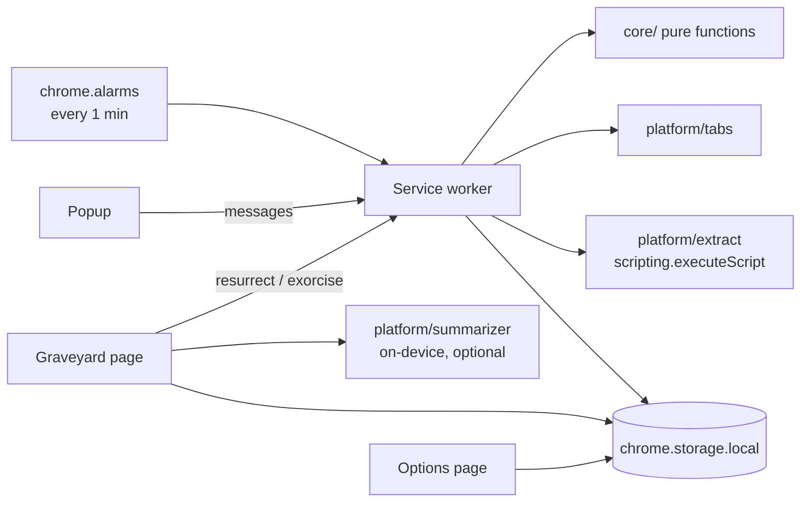

# Design Document

## Overview

Tab Graveyard is a Manifest V3 extension with no backend. A service worker wakes on a one-minute alarm, asks pure functions which tabs to bury, saves a Grave for each, and closes the tab. The Graveyard page reads Graves from `chrome.storage.local` and renders them as tombstones.

Two decisions shape the design:

1. **All decisions are pure functions.** Selection, deduplication, decay, expiry, epitaph and search take plain data and return plain data. Only thin adapters touch `chrome.*`. This makes the risky logic (closing the user's tabs) property-testable.
2. **Save before close, open before delete.** A tab is closed only after its Grave is stored; a Grave is removed only after its tab is reopened. A failure at any point leaves the user with a duplicate, never a loss.

## Architecture



### Burial flow

1. Alarm fires (or Popup sends `buryIdle` / `buryTab`).
2. Service worker loads settings and queries tabs.
3. `selectBurialCandidates(tabs, settings, now)` returns the tabs to bury.
4. For each candidate: extract page info (2 s timeout) → `fallbackEpitaph` → `addGrave` → write storage → on success `tabs.remove`.
5. `expiredGraves` runs on the same alarm and removes Graves past the Retention Period.

### Resurrection flow

1. Graveyard sends `resurrect(id)`.
2. Service worker calls `tabs.create({ url })`. On success it removes the Grave and increments `stats.resurrected`. On failure it replies with an error and the Grave stays.

### AI epitaph upgrade

The built-in Summarizer API is exposed to window contexts, so it is called from the Graveyard page, not the service worker (verify against current Chrome docs during implementation). At burial, the Grave stores a short text excerpt alongside the fallback Epitaph. When the Graveyard opens and a summarizer is available, it summarizes each Grave that still has an excerpt, saves the new Epitaph with `epitaphSource: 'ai'`, and deletes the excerpt. If no summarizer exists (for example on Edge), the fallback Epitaph simply stays. The excerpt is dropped after 7 days either way to keep storage small.

## Components and Interfaces

### `src/core/` (pure, no `chrome.*`)

```ts
selectBurialCandidates(tabs: TabInfo[], settings: Settings, now: number): TabInfo[]
isProtected(tab: TabInfo, protectedSites: string[]): boolean
canBuryManually(tab: TabInfo): boolean            // http(s) and not incognito
fallbackEpitaph(page: PageInfo): { text: string; source: EpitaphSource }
addGrave(graves: Grave[], grave: Grave, cap: number): Grave[]   // dedupe by url, enforce cap
expiredGraves(graves: Grave[], retentionDays: number | null, now: number): Grave[]
decayStage(buriedAt: number, now: number): 'fresh' | 'weathered' | 'crumbling'
searchGraves(graves: Grave[], query: string): Grave[]
sortGraves(graves: Grave[]): Grave[]              // newest first
normalizeSettings(raw: unknown): Settings         // defaults + clamping
validateSetting(key, value): { ok: true } | { ok: false; range: string }
estimateFreedMb(buried: number): number
```

### `src/platform/` (adapters)

| Module | Wraps | Notes |
|---|---|---|
| `tabs.ts` | `chrome.tabs.query/remove/create` | Maps `chrome.tabs.Tab` to `TabInfo` using `lastAccessed` |
| `storage.ts` | `chrome.storage.local` | `getGraves/setGraves/getSettings/setSettings/getStats/setStats`, `onChanged` subscription |
| `extract.ts` | `chrome.scripting.executeScript` | Returns `PageInfo`; rejects after 2 s or on discarded tabs |
| `summarizer.ts` | `Summarizer` global | `isAvailable()`, `summarize(text)`; returns `null` when unsupported |

### `src/background/service-worker.ts`

- Registers the `bury-check` alarm (1 minute) on install and startup.
- Handles messages: `buryTab`, `buryIdle`, `resurrect`, `exorcise`.
- Serialises burial work in one queue so two alarms never write Graves concurrently.

### UI pages

- **Graveyard** (`src/graveyard/`): tombstone grid, search field, stats bar, live updates via `storage.onChanged`, an `aria-live` region for action results. Scene layers (sky, fog, ground) are CSS only; fog and flicker animations are wrapped in `@media (prefers-reduced-motion: no-preference)`.
- **Popup** (`src/popup/`): grave count, "Bury this tab", "Bury idle tabs now", "Open graveyard".
- **Options** (`src/options/`): the four settings with inline range errors.

### Permissions

`tabs`, `storage`, `alarms`, `scripting`, and host permission `<all_urls>` (needed to read the meta description and first paragraph before closing). No network permissions are used for sending data.

## Data Models

```ts
interface TabInfo {
  id: number; url: string; title: string; favIconUrl?: string;
  active: boolean; pinned: boolean; audible: boolean; incognito: boolean;
  lastAccessed: number;            // ms epoch
}

interface PageInfo { title: string; metaDescription?: string; firstParagraph?: string; excerpt?: string }

type EpitaphSource = 'ai' | 'meta' | 'paragraph' | 'title';

interface Grave {
  id: string;                      // crypto.randomUUID()
  url: string; title: string; domain: string; favIconUrl?: string;
  buriedAt: number; lastAccessed: number;
  epitaph: string;                 // 1..200 chars
  epitaphSource: EpitaphSource;
  excerpt?: string;                // up to 4,000 chars, removed after AI upgrade or 7 days
}

interface Settings {
  autoBury: boolean;               // default true
  idleMinutes: number;             // 5..1440, default 30
  protectedSites: string[];        // lower-case domains, default []
  retentionDays: number | null;    // 1..365 or null (Never), default 30
}

interface Stats { buried: number; resurrected: number }
```

Storage keys: `graves`, `settings`, `stats`. Constants: `GRAVE_CAP = 2000`, `EPITAPH_MAX = 200`, `EST_MB_PER_TAB = 50` (shown as "≈", never as a measurement).

A domain matches Protected Sites when it equals a listed domain or is a subdomain of it (`docs.example.com` matches `example.com`).

## Correctness Properties

*A property is a rule that must hold for every valid input, not only for hand-picked examples. Each property below is implemented as a fast-check property test.*

**Property 1: Protected tabs are never selected.**
For any list of tabs, settings and time, `selectBurialCandidates` returns no tab that is active, pinned, audible, incognito, non-http(s), or on a protected domain.
**Validates: Requirements 1.3**

**Property 2: Selection is exactly the idle, unprotected tabs.**
For any list of tabs, settings with `autoBury` on, and time, a tab is returned if and only if it is not protected and `now - lastAccessed >= idleMinutes`.
**Validates: Requirements 1.2, 2.2**

**Property 3: Auto-Bury off selects nothing.**
For any tabs and time, when `autoBury` is false the automatic check buries no tab.
**Validates: Requirements 1.6**

**Property 4: Graves stay unique and capped.**
For any existing list of Graves with unique addresses and any new Grave, `addGrave` returns a list that contains the new Grave's address exactly once, has no duplicate addresses, and has at most `cap` entries; when entries are dropped, they are the oldest.
**Validates: Requirements 3.7, 6.5**

**Property 5: Burial preserves the address.**
For any buryable tab, the Grave produced from it has `url` identical to the tab's address, so resurrecting it opens the same page.
**Validates: Requirements 3.1, 5.1**

**Property 6: Epitaphs are always valid.**
For any `PageInfo` (including empty, whitespace-only and very long strings), `fallbackEpitaph` returns text that is non-empty after trimming and at most 200 characters, and picks sources in the order meta, paragraph, title.
**Validates: Requirements 3.2, 3.3, 3.6**

**Property 7: Decay never reverses.**
For any `buriedAt` and times `t1 <= t2`, the stage at `t2` is the same as or later than the stage at `t1`, and the stage boundaries fall at exactly 1 day and 7 days.
**Validates: Requirements 6.1**

**Property 8: Expiry removes only old Graves.**
For any Graves, retention and time, `expiredGraves` returns exactly the Graves older than the retention; with retention `null` it returns none.
**Validates: Requirements 6.3, 6.4**

**Property 9: Search returns matching Graves only.**
For any Graves and query, every result contains the query (ignoring case) in title, domain or Epitaph, every Grave that matches is in the result, and an empty query returns all Graves.
**Validates: Requirements 4.3**

**Property 10: Settings are always in range.**
For any input value, `normalizeSettings` returns settings inside the allowed ranges, and applying it twice gives the same result as applying it once.
**Validates: Requirements 8.1, 8.3**

## Error Handling

| Situation | Behaviour | Requirement |
|---|---|---|
| Storage write fails during burial | Tab stays open; error logged; retry on next alarm | 1.5 |
| Page extraction times out or tab is discarded | Use title as Epitaph, continue burial | 3.6 |
| `tabs.create` fails on Resurrect | Grave kept; Graveyard shows "Could not reopen this page" | 5.2 |
| Tab closed by the user mid-burial | Grave is kept (the page is still recoverable) | 1.4 |
| Summarizer missing or throws | Fallback Epitaph kept, no error shown | 3.4 |
| Stored data has an unexpected shape | `normalizeSettings` restores defaults; invalid Graves are skipped, not deleted | 8.4 |
| Service worker restarted | Alarm re-registered on `onStartup` and `onInstalled` | 1.1 |

## Testing Strategy

- **Property-based tests (fast-check, 100+ runs each):** the ten properties above, one test per property, each tagged `Feature: tab-graveyard, Property N`.
- **Unit tests (Vitest):** concrete examples and edge cases for the same functions: boundary at exactly the Idle Threshold, subdomain matching, 200-character truncation on a multi-byte string, empty Grave list.
- **Orchestration tests:** service worker burial and resurrection flows with fake `platform/` adapters, covering "save fails → tab not closed" and "create fails → Grave kept".
- **Manual checks before submission:** load unpacked in Chrome and Edge; keyboard-only pass through Graveyard, Popup and Options; reduced-motion on; 360 px width; contrast check on tombstone text.
